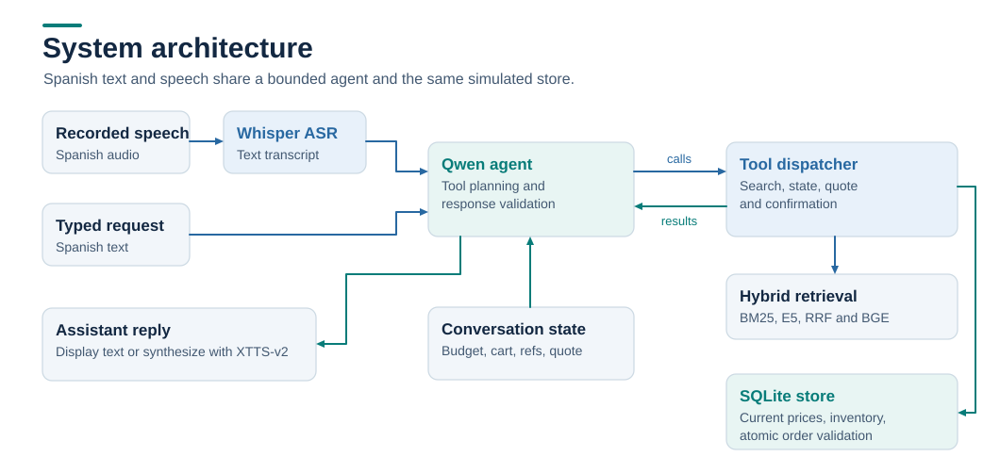

# Voice-RAG Shopping Agent: A Multimodal Deep Learning Assistant for Conversational Commerce

**UTEC Posgrado · MCD8016 Deep Learning · Laboratory 4 · Group 8**

Voice-RAG is a Spanish-language research prototype for shopping by text or speech. It retrieves products from an Amazon ESCI catalog, asks for clarification when needed, manages a cart and quotation across turns, and can synthesize replies in the voice of an authorized reference speaker. All orders, prices, and inventory are simulated.

[Español](LEEME.md) · [Architecture](docs/ARCHITECTURE.md) · [Experiments](docs/EXPERIMENTS.md) · [Demonstration](docs/DEMONSTRATION.md) · [Reproducibility](docs/REPRODUCIBILITY.md) · [Data availability](docs/DATA_AVAILABILITY.md)

## System

1. **Speech and text.** Whisper large-v3-turbo transcribes recorded Spanish input. Text can enter the same agent directly. XTTS-v2 synthesizes the final voice response. An ECAPA-TDNN speaker encoder is used for evaluation.
2. **Hybrid retrieval.** Spanish BM25 and `intfloat/multilingual-e5-base` retrieve candidates independently. Reciprocal Rank Fusion merges their rankings, and `BAAI/bge-reranker-v2-m3` reranks the top 50.
3. **Tool-using agent.** The selected model, `Qwen/Qwen3.5-9B`, receives structured conversation state and tool results over multiple steps. Its nine tools cover product search and details, live price and stock, cart updates and inspection, budget and preferences, quotation, and order confirmation. The official Colab backend uses 4-bit NF4 with bfloat16 compute on an NVIDIA L4.
4. **Transactional store.** SQLite stores prices in integer cents and records inventory, carts, quotations and orders. Confirmation requires an explicit user turn after quotation. A transaction rechecks price, stock and budget, and repeated confirmation of a committed quote returns the existing order.

The lab used pretrained checkpoints for inference. Model identifiers, retrieval settings and store invariants are described in [Architecture](docs/ARCHITECTURE.md).

## Data and evaluation

The reduced Spanish ESCI subset contains **218,774** query–product pairs. At seed **42**, 200 development queries and 250 held-out test queries yielded a catalog of **11,463 products** and **6,615** test judgments. Test relevance labels are isolated from agent inference. The catalog and judgments can be regenerated from upstream ESCI.

### Retrieval

| Method | nDCG@10 on annotated candidates | Exact Recall@50 in full catalog |
|---|---:|---:|
| BM25 | 0.7043 | 78.16% |
| Dense E5 | 0.7433 | 76.48% |
| Hybrid RRF | 0.7357 | 82.31% |
| Hybrid RRF + re-ranker | **0.7884** | — |

RRF raised full-catalog candidate recall while its annotated-candidate nDCG@10 was below dense E5. The paired ablation yielded **+0.05276** nDCG@10 for the re-ranker over RRF alone.

### Operational and voice results

| Colab model | Successful scenarios | Recorded violations | Mean agent time |
|---|---:|---:|---:|
| Qwen2.5-7B | 8/20 | 1 | 6.2 s/turn |
| Qwen3-8B | 14/20 | 1 | 8.2 s/turn |
| Qwen3.5-9B | **16/20** | **0** | 11.6 s/turn |

Agent time averages the mean time per turn within each scenario, giving every scenario equal weight. Qwen3.5-9B had the highest observed success rate and the highest mean latency. Zero recorded violations describes this sample.

The voice study repeated **six of the 20 scenarios** using recorded input and again using the correct transcriptions. Both conditions passed **3/6**. Across 25 audio turns, mean normalized ASR WER was **0.00%**, mean re-transcribed TTS WER **5.24%**, and mean ECAPA cosine similarity **0.816**. End-to-end latency was **21.34 s** mean, **20.76 s** median and **29.16 s** P90. The separate voice loading and warm-up measurement was **4.03 min**. The Colab integration run recorded **10.89 GiB** peak PyTorch-allocated GPU memory.

The [demonstration case notes](docs/DEMONSTRATION.md) describe a completed two-cable order and the limitations exposed by compatibility, product selection and recovery cases. Store-level validation and paired retrieval evaluation support controlled comparisons. The small scenario set, one input speaker, synthetic commerce state and roughly 21-second voice turns limit generalization to wider deployment. [Experiment details and provenance](docs/EXPERIMENTS.md)

## Colab and repository layout

Use a Drive folder named `MyDrive/lab4/` with `data/` and `lab4_solution/` as siblings. Start with notebook 01 on a fresh dataset, then use 02–06 as described in the [reproduction guide](docs/REPRODUCIBILITY.md). Notebook 00 is an optional integration check once the prepared catalog and its audio inputs exist. The clean notebook copies preserve their original code and were validated statically. The Colab setup cells install the package using the included `lab4_solution/pyproject.toml`.

| Included path | Contents |
|---|---|
| [`docs/`](docs/) | Technical documentation and scientific figures |
| [`lab4_solution/README.md`](lab4_solution/README.md) | Implementation setup and dependencies |
| [`lab4_solution/src/asistente_compras/`](lab4_solution/src/asistente_compras/) | Application package |
| [`lab4_solution/tests/`](lab4_solution/tests/) | Existing unit tests |
| [`lab4_solution/notebooks_public/`](lab4_solution/notebooks_public/) | Seven notebooks, with reviewed Colab outputs in 00, 03, 05 and 06 |
| [`lab4_solution/scripts/`](lab4_solution/scripts/) | Distribution and Colab packaging utilities |
| [`lab4_solution/uv.lock`](lab4_solution/uv.lock) | Recorded dependency versions and source hashes |

This repository includes reviewed results in Markdown and SVG. Original notebooks, catalogs, indexes, recordings, conversation traces and academic material remain local. The original voice measurements require the original recordings. A new authorized reference and new scenario recordings support replication of the methodology. [Data availability and rights](docs/DATA_AVAILABILITY.md)

## Acknowledgments

- Dataset — [Amazon ESCI](https://github.com/amazon-science/esci-data)
- Retrieval and language models — [Multilingual E5](https://huggingface.co/intfloat/multilingual-e5-base), [BGE Reranker](https://huggingface.co/BAAI/bge-reranker-v2-m3), and [Qwen](https://github.com/QwenLM)
- Speech — [Whisper](https://github.com/openai/whisper), [XTTS-v2](https://huggingface.co/coqui/XTTS-v2), and [SpeechBrain](https://github.com/speechbrain/speechbrain)
- Libraries — [PyTorch](https://pytorch.org/) and [Hugging Face Transformers](https://github.com/huggingface/transformers)

## Contributors

This project was developed by Group 8 as part of the Deep Learning course (MCD8016) at UTEC Posgrado.

- Carlos Irazabal
- Lucio Villa Ramos
- Manuel Fernando Polo Castillo
- Gavino Vicente Maccerhua De la Cruz
