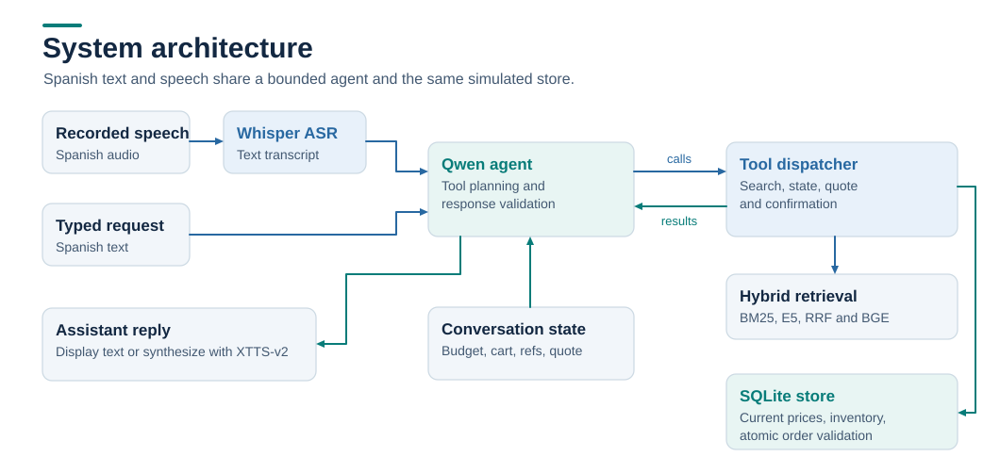
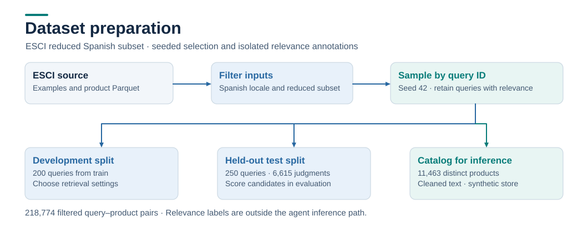
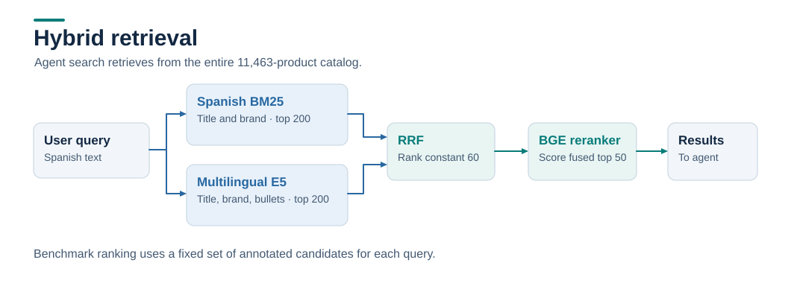
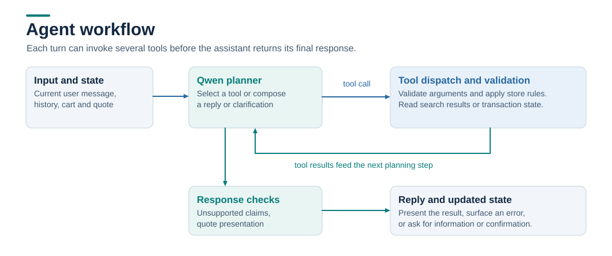
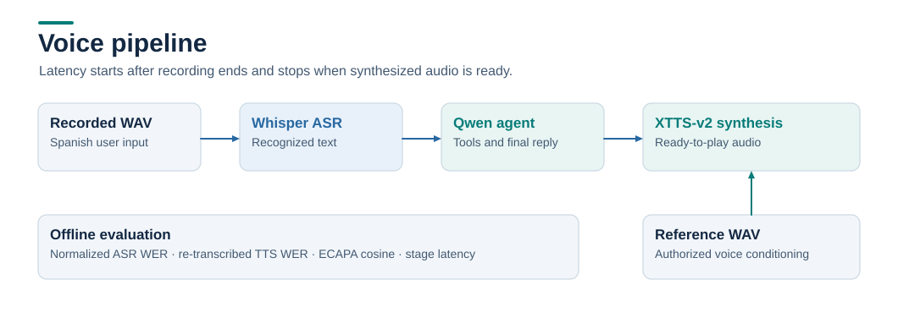

# System architecture

Voice-RAG implements Spanish shopping on a simulated catalog. Text and recorded audio share the same agent, tools and SQLite store. The agent's response can be returned as text or passed to voice synthesis.

## Data path

ESCI examples are filtered to the Spanish locale and reduced benchmark. The split is by query ID, with 200 training-split queries for development and 250 test-split queries for evaluation. Queries whose annotated candidates are all irrelevant are excluded because ideal DCG is zero. A fixed seed of 42 drives sampling and the simulation. Catalog product IDs are the union of IDs judged for the sampled queries. The configured minimum is 5,000 products, with zero distractors needed in this run.

Catalog text is cleaned and kept separately from query relevance judgments. Test labels are read by the evaluation module. At inference the retriever uses catalog text, and product tools fetch current price and stock from SQLite. Empty product attributes are treated as unknown.

## Retrieval

| Component | Configuration |
|---|---|
| Lexical | `bm25s` with Spanish stemming and stop words. Indexes title and brand. |
| Dense | `intfloat/multilingual-e5-base`. Indexes title, brand and bullets. Uses `query:` and `passage:` prefixes, normalized vectors and dot products. Catalog embeddings can be cached. |
| Fusion | Reciprocal Rank Fusion with constant 60. Full-catalog search fuses up to 200 entries from each component. |
| Re-ranker | `BAAI/bge-reranker-v2-m3` cross-encoder scores the fused top 50, with a maximum pair length of 384 tokens. E5 and the re-ranker use half precision on CUDA in the implementation. |

For benchmark nDCG, each method reorders the annotated candidate set for the query. Full-catalog Recall@50 uses unconstrained search, then matches returned product IDs against known Exact products.

## Agent and transaction boundary

The LLM receives conversation history and an updated state block containing the budget, preferences, cart, shown product references, active quote and order. Product references such as R1 resolve to catalog IDs through the state. The bounded tool loop dispatches typed tool calls and feeds the results into the next model step. The implementation handles Qwen's JSON and XML tool formats. The application extracts explicit total budgets, can supply or refresh a quotation, and checks common unsupported action claims before returning a response.

| Tool family | Operations |
|---|---|
| Browse | Search, product details, current price and stock |
| State | Set budget, record preferences, view cart, set cart quantity |
| Purchase | Quote cart, confirm order |

The store represents prices in integer euro cents. A quote captures the cart and prevailing price and validates quantity, stock and budget. Agent-side dispatch requires explicit confirmation after the quote was shown in a previous turn. SQLite revalidates the quote inside `BEGIN IMMEDIATE` and applies stock and order updates atomically. The quote ID is unique in the orders table, so repeating confirmation of an already committed quote returns its existing order. Failed revalidation permits recovery on a later user turn. The LLM still determines whether it searches for a different product or asks a useful clarification.

## Models and execution

| Role | Identifier and runtime |
|---|---|
| ASR | Whisper large-v3-turbo via `faster-whisper` (model alias `large-v3-turbo`), CUDA `int8_float16`, Spanish, beam 5, VAD enabled, temperature 0. |
| LLM | `Qwen/Qwen2.5-7B-Instruct`, `Qwen/Qwen3-8B` and `Qwen/Qwen3.5-9B` via Transformers. The chosen model was Qwen3.5-9B. The Colab backend uses bitsandbytes NF4 double quantization, bfloat16 compute on supported GPUs and float16 fallback. Greedy decoding is used. Thinking is disabled by template for Qwen3 and Qwen3.5. The agent supplies text to the Qwen3.5 checkpoint. |
| TTS | Coqui `tts_models/multilingual/multi-dataset/xtts_v2`, Spanish synthesis conditioned on audio from an authorized speaker. Response text is normalized and split before synthesis. |
| Speaker evaluation | SpeechBrain `speechbrain/spkrec-ecapa-voxceleb`, ECAPA-TDNN cosine similarity, run on CPU in the official voice notebook. |

Speech and language inference run on the lab runtime. Fresh environments need access to download dependencies and checkpoints. Apple Silicon development uses Ollama and `mlx-community/whisper-large-v3-turbo` and has separate experimental artifacts. The recorded results use pretrained models without training or fine-tuning.
