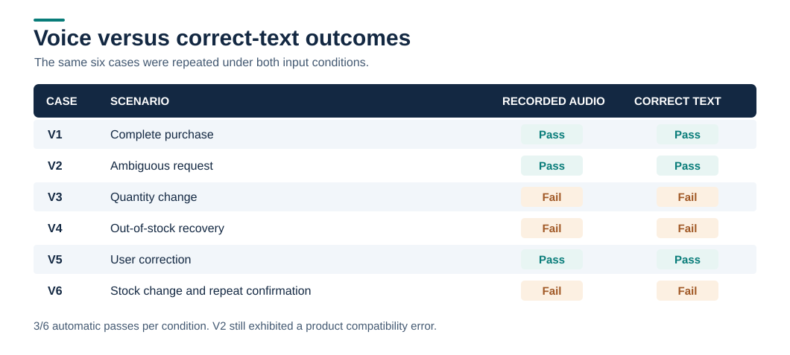

# Demonstration and scenario interpretation

The case summaries reflect saved Colab observations. Automated results use the scenario checks. The qualitative notes consider the product selected, when a quotation was presented and whether the model followed the requested recovery behavior.

| Case | Purpose | Voice | Correct text | Observed behavior in the voice trace |
|---|---|---|---|---|
| V1 | Complete purchase | Pass | Pass | Two USB-C cables were ordered for EUR 17.98 under a EUR 40 budget. |
| V2 | Ambiguous request | Pass | Pass | The chosen case was listed for iPhone 8 Plus / iPhone 7 Plus. The request specified iPhone 8. |
| V3 | Quantity change | Fail | Fail | Quantity was updated to five and the budget was preserved. The selected item was a folding container, while the request called for bottles. |
| V4 | Out-of-stock recovery | Fail | Fail | The agent checked availability and tried already shown products. It did not initiate a fresh search after depletion and no order was recorded. |
| V5 | User correction | Pass | Pass | The order changed from 50 to 15 sets of 72 pieces, with a revised quote and explicit confirmation. |
| V6 | Stock change and duplicate confirmation | Fail | Fail | One order was recorded, but the intended stock-change handling did not occur. The evaluator found no `stock_changed` error in the trace. |

## Successful quotation sequence

In V1, the first turn registered the EUR 40 budget and handed matching products to the conversation. The next turn put two units in the cart. The agent's code automatically generated and presented **Q0001** at **EUR 17.98**. On the user's later confirmation turn, the quote tool returned that same quotation marked as already presented, then the order tool committed one order. The quotation seen during confirmation was a repeat of the earlier quote.

In V5, the original quote covered 50 sets. After the user's scripted correction, the agent issued a new quote for 15 sets and committed it following a later confirmation. This change was part of the scenario design. The recognizer matched the normalized reference on those turns.

## Selected text-only cases

For Qwen3.5-9B in the Colab comparison:

| Case | Automated result | Interpretation |
|---|---|---|
| T08 | Pass | The budget was insufficient and no purchase was made. |
| T11 | Pass | One order contained a mouse and a backpack within the budget. |
| T17 | Pass | The requested quantity exceeded stock and no order was made. |
| T20 | Fail | Price revalidation rejected the old quote. A renewed quote was recorded, and the scenario ended without an order. |

The trace review used locally retained `data/voz_resultados_colab/trazas/` and `data/scenarios/qwen35_9b_colab/`. The summary includes outcomes and transaction facts without full conversations, recordings, catalog entries or participant details.
