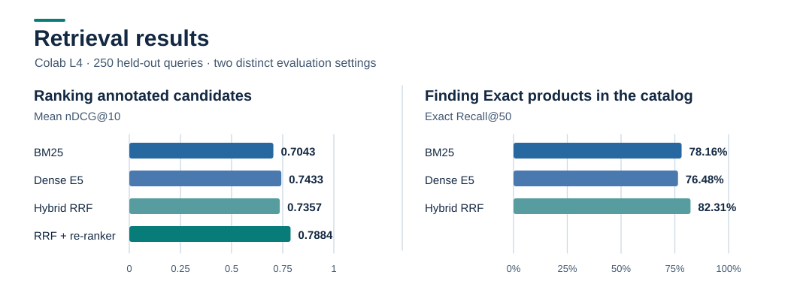
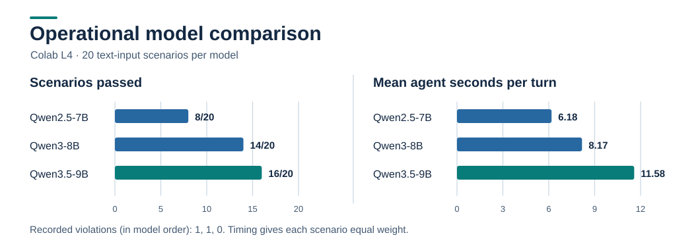
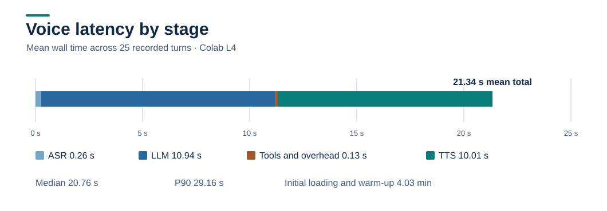

# Experimental design and results

The official retrieval, operational and voice results come from Google Colab on an NVIDIA L4. The original notebooks 00, 03, 05 and 06 contain the saved Colab outputs. The supplementary Mac notebooks and Mac-specific output directories record preliminary development runs. The main notebooks 01, 02 and 04 have local setup and demonstration evidence. The publication copies of notebooks 00, 03, 05 and 06 include the reviewed experimental outputs from Colab.

## Dataset

| Component | Count |
|---|---:|
| Spanish ESCI query–product pairs after filtering | 218,774 |
| Catalog products | 11,463 |
| Development queries | 200 |
| Test queries | 250 |
| Test judgments | 6,615 |
| Reproducibility seed | 42 |

| ESCI label | Test pairs | Gain |
|---|---:|---:|
| Exact | 2,835 | 1.00 |
| Substitute | 2,104 | 0.10 |
| Complement | 512 | 0.01 |
| Irrelevant | 1,164 | 0.00 |

Development queries come from the original training split. Test queries come from the held-out split. Product prices and stock use a seeded simulation. The agent's inference path reads product and store data. Relevance judgments are read by the evaluation path.

## Retrieval

Each method ranked the same annotated candidates for each of the 250 test queries, an average of 26.46 candidates per query. The table reports mean nDCG@10 and bootstrap 95% confidence intervals across queries. The median times are per query during annotated-candidate evaluation.

| Method | Mean nDCG@10 | Bootstrap 95% CI | Median ms/query | Exact Recall@50 |
|---|---:|---:|---:|---:|
| BM25 | 0.7043 | 0.6769–0.7325 | 0.20 | 78.16% |
| Dense E5 | 0.7433 | 0.7165–0.7666 | 15.26 | 76.48% |
| Hybrid RRF | 0.7357 | 0.7099–0.7612 | 16.87 | 82.31% |
| Hybrid RRF + re-ranker | **0.7884** | 0.7647–0.8127 | 143.82 | — |

The full model improved over BM25 by **0.08417** nDCG@10 (paired Wilcoxon `p = 3.70 × 10⁻¹²`). In the component ablation on the same test queries, adding the re-ranker improved mean nDCG@10 by **0.05276**, with 143 higher, 27 unchanged and 80 lower query scores. Recall@50 is measured separately over the full 11,463-product catalog. For each query with at least one Exact product, the code computes the fraction of Exact products in the first 50 results and averages those fractions across queries. RRF reached the highest reported candidate recall and scored below dense E5 on annotated-candidate nDCG@10. Re-ranking improved candidate ordering and added latency.

Locally retained evidence comprises `data/manifest.json`, `data/index/retrieval_test_resumen.csv`, `data/index/retrieval_test_por_consulta.parquet` and the original Colab notebook 03. The per-query Parquet means and paired differences were checked against the summary. Recall@50 comes from the saved full-catalog evaluation in notebook 03.

## Operational model comparison

The harness restores a deterministic initial store for each scenario and applies scenario-specific fixtures and stock or price events. It evaluates action, state and response checks and counts predetermined violations, including over-budget orders, incorrect quantities, duplicate orders, orders without confirmation and negative stock. A pass requires satisfying all scenario checks with zero recorded violations. The 20 text-input scenarios include V1–V6 and T07–T20.

| Model | Passes | Recorded violations | Mean agent s/turn |
|---|---:|---:|---:|
| Qwen2.5-7B | 8/20 (40%) | 1 | 6.18 |
| Qwen3-8B | 14/20 (70%) | 1 | 8.17 |
| Qwen3.5-9B | **16/20 (80%)** | **0** | 11.58 |

Time is the arithmetic mean of `seconds_per_turn` over the 20 scenarios. Each `seconds_per_turn` is itself total agent processing time divided by the scenario's turn count. Each scenario contributes equally. ASR, speech synthesis and initial model loading are outside this timing. Qwen3.5-9B was selected because it completed the most scenarios and had zero recorded violations. It was slower than the alternatives, and the observed zero does not establish universal correctness.

Locally retained evidence comprises `data/scenarios/qwen25_7b_colab/resumen.csv`, `data/scenarios/qwen3_8b_colab/resumen.csv`, `data/scenarios/qwen35_9b_colab/resumen.csv` and the original Colab notebook 05. The saved notebook contains a broad zero-violation note. The per-model CSVs record one violation each for the two smaller models and are the basis for the table.

## Voice and correct-transcription comparison

Notebook 06 reran V1–V6 with recorded Spanish audio and with their correct transcripts under the selected model. These six scenarios are a subset of the 20-scenario suite. Both conditions passed **V1, V2 and V5** and failed **V3, V4 and V6**. Correct text provides a control for recognition errors in these cases. Qualitative inspection still identified a compatibility error in the automatically passing V2. [Scenario summaries](DEMONSTRATION.md)

| Voice indicator | Value |
|---|---:|
| Recorded user turns | 25 |
| Successful audio-input scenarios | 3/6 |
| Successful correct-text scenarios | 3/6 |
| Mean normalized ASR WER | 0.00% |
| Mean re-transcribed TTS WER | 5.24% |
| Mean ECAPA cosine similarity | 0.816 |
| End-to-end mean | 21.34 s |
| End-to-end median | 20.76 s |
| End-to-end P90 | 29.16 s |
| Initial loading and warm-up | 4.03 min |
| Peak PyTorch-allocated GPU memory in the separate integration run | 10.89 GiB |

ASR WER uses normalized words, with the implementation standardizing formats such as numbers. TTS WER compares the intended spoken text with ASR re-transcription of the synthesis, so it is a proxy for intelligibility. ECAPA cosine similarity compares the reference with each generated response. These are means over 25 turns. There is no independent listening panel.

| Mean stage | Seconds |
|---|---:|
| ASR | 0.26 |
| LLM | 10.94 |
| Tools and other overhead | 0.13 |
| TTS | 10.01 |

End-to-end latency runs from the end of input recording to the point when synthesized audio is ready for playback, excluding playback itself. Tools and other overhead is computed as total time minus ASR, LLM and TTS before rounding. The tool-and-retrieval column alone averages **0.12 s**. P90 uses linear interpolation. The loading figure sums the stages and measured warm-up calls in notebook 06. The memory value is from notebook 00's `torch.cuda.max_memory_allocated() / 2**30` on the L4 and covers the integration run's peak PyTorch tensor allocation. GPU allocator reserves and allocations made by other runtimes are outside this counter.

Locally retained voice evidence comprises `data/voz_resultados_colab/asr_por_turno.csv`, `data/voz_resultados_colab/carga_inicial.csv`, `data/voz_resultados_colab/latencias.csv`, `data/voz_resultados_colab/tts_calidad.csv`, `data/voz_resultados_colab/voz_vs_texto.csv`, traces under `data/voz_resultados_colab/trazas/` and the original Colab notebooks 00 and 06. The stage and quality means were recomputed from the retained CSVs. Some narrative cells describe Mac development runs. The reported voice values come from the Colab artifacts and corresponding saved tables.

## Limitations

The operational scenarios are fixed tests on simulated products, prices and stock behavior. The recorded sample covers 25 turns from one speaker, with no stratification by accent, recording environment or speaker. Text and voice model settings, hardware and package versions can influence the outcome of a repeat. Automated validators check specified transaction and conversation conditions and can miss catalog compatibility or unsuitable choices. Tool validation can reject invalid writes while leaving the model responsible for the follow-up action. Nearly all mean voice latency came from LLM inference and TTS.

Machine-readable aggregates are available for [retrieval](results/retrieval.csv), [operational scenarios](results/operations.csv) and [voice](results/voice.csv).
